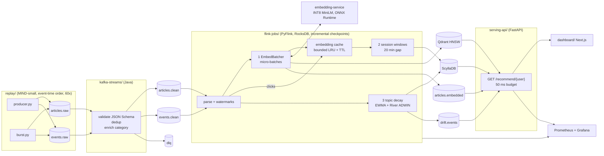

# Real-Time Session-Based News Recommender on Apache Flink

Big Data Computing case study (VESIT, AI & DS) by **Amey Vichave (51)** and **Soham Tejwani (61)**.
It implements, on one laptop, the design in [docs/case-study.pdf](docs/case-study.pdf):

- **CA1: news recommendation from streaming articles.** New articles are embedded the moment they're
  published, so they're recommendable before anyone has clicked them (item cold start).
- **CA2: optimising stateful stream processing and memory eviction in Apache Flink.** Keyed state, event-time
  session windows, three separate State TTLs, a bounded LRU cache in keyed state, and RocksDB incremental
  checkpoints, plus an ablation experiment showing what eviction buys.

For a full walkthrough written for a reader new to the project, see [docs/PROJECT_GUIDE.md](docs/PROJECT_GUIDE.md).

## Architecture



The flow of an article: it's published to Kafka, cleaned by Kafka Streams, micro-batched in Flink, embedded by
the INT8 encoder, inserted into Qdrant (now **retrievable**), and published on `articles.embedded`. A click on it
then flows through the embedding cache to the user's **session window**, which writes a fresh session vector to
ScyllaDB. The same events also feed the **topic decay** operator: per-category engagement, ADWIN drift detection,
an adapted half-life, and roll-ups to ScyllaDB. `/recommend` blends ANN similarity from Qdrant with decayed
engagement scores.

## Requirements

- Docker Desktop with WSL2, limited to 4.5 GB (`C:\Users\<you>\.wslconfig`: `[wsl2]` `memory=4608MB` `swap=4GB`).
- Node 18+ for the dashboard (it runs outside Docker).
- About 15 GB of free disk for images and data.
- `make`, or `mingw32-make` on Windows. Every target is a plain `docker compose` command, so you can copy them out of the [Makefile](Makefile).

## Run the demo

```bash
make data          # download MIND-small (commit-pinned HF mirror) + build the 2-day / 5,000-user subset
make up            # core stack + topics/collection/schema + submit the Flink job
make up-all        # same, plus Prometheus (localhost:9090) and Grafana (localhost:3001)
make replay        # replay the subset at 60x (2 days of news in ~48 min); Ctrl-C any time
make burst         # in a second terminal while the replay runs: "breaking news" flood in sports
make loadgen       # steady /recommend traffic so latency metrics have data
make smoke         # end-to-end smoke test
make test          # unit tests
```

Dashboard (production build, as recommended for demos):

```bash
cd dashboard && npm install && npm run build && npm start     # http://localhost:3000
```

| URL | What |
|---|---|
| http://localhost:3000 | Dashboard: live feed, user recommendations, topic drift, latency |
| http://localhost:8000/docs | Serving API (Swagger): `/recommend/{user_id}`, `/stats`, `/topics`, `/drift` |
| http://localhost:8081 | Flink web UI: job graph, checkpoints, backpressure |
| http://localhost:3001/d/newsrec | Grafana dashboard (monitoring profile) |
| http://localhost:6333/dashboard | Qdrant UI |

**Fallback demo.** Run `curl -X POST "localhost:8000/admin/qdrant-delay?ms=80"`. Requests switch to the `fallback`
path (in-memory recent-articles cache) and stay inside the budget. Set `ms=0` to restore.

**Burst demo.** Run `make burst` while the replay is going. Within a few event-minutes `drift.events` reports a
`spike` for `sports`, the half-life drops from 6 h to 3 h (Topics page), and the overview shows the detection lag.

## Memory budget (core profile, every container has `mem_limit`)

| Container | Limit | Notes |
|---|---|---|
| Kafka (KRaft) | 512 MB | `-Xmx384m`, 1 h retention |
| Kafka Streams | 256 MB | `-Xmx192m`, in-memory stores |
| Flink JobManager | 640 MB | |
| Flink TaskManager | 1400 MB | 2 slots, RocksDB with managed memory, PyFlink workers |
| Embedding service | 450 MB | 1 worker, `intra_op_num_threads=2` |
| Qdrant | 300 MB | vectors `on_disk`, HNSW m=16 |
| ScyllaDB | 700 MB | `--smp 1 --memory 500M` (600M does not fit a 700 MB cgroup) |
| Serving API | 200 MB | |
| **Total** | **≈ 4.46 GB** | measured usage ≈ 2.9–3.2 GB during a 60x replay (`make stats`) |

## Report section → code (viva map)

| Report section | What it says | Where it is implemented |
|---|---|---|
| 3.1, 4.3, 5.2 Cold start | Content-only embeddings for brand-new articles; quantized encoder; micro-batching | [embedding-service/scripts/quantize.py](embedding-service/scripts/quantize.py), [embedding-service/app/encoder.py](embedding-service/app/encoder.py), [embedding-service/app/main.py](embedding-service/app/main.py) (`MicroBatcher`), [flink-jobs/newsrec/operators.py](flink-jobs/newsrec/operators.py) (`EmbedBatcher`) |
| 4.3 Index churn | Batch inserts into HNSW | `EmbedBatcher._flush` (one upsert per micro-batch), [infra/init/init.py](infra/init/init.py) (HNSW m=16, on-disk vectors) |
| 4.1 Keyed state, session windows, watermarks | Per-user state; inactivity-gap sessions; out-of-order clicks | [flink-jobs/newsrec/job.py](flink-jobs/newsrec/job.py), `SessionVectorAgg` / `SessionWriter`, [newsrec_core/session.py](newsrec_core/session.py) |
| 4.2 Memory eviction | TTL with compaction cleanup, session purging, tiered LRU cache | `ttl_config`, `EmbeddingCacheJoin` ([operators.py](flink-jobs/newsrec/operators.py)), [newsrec_core/lru.py](newsrec_core/lru.py), `eviction:` in [config/pipeline.yaml](config/pipeline.yaml) |
| 3.2, 4.4, 5.3 Decay & drift | exp decay with per-topic half-life; ADWIN; spike/slow-burn response; roll-up to Cassandra | `TopicDecayDrift`, [newsrec_core/decay.py](newsrec_core/decay.py), [newsrec_core/drift.py](newsrec_core/drift.py), [infra/scylla/schema.cql](infra/scylla/schema.cql) |
| 5.1 Ingestion | Kafka + Kafka Streams validation, dedup, enrichment | [kafka-streams/](kafka-streams/src/main/java/newsrec/cleaner/), [replay/producer.py](replay/producer.py) |
| 5.1 Serving | Session vector × ANN + decayed warm scores | [serving-api/app/main.py](serving-api/app/main.py), [newsrec_core/blend.py](newsrec_core/blend.py) |
| 4.5 Latency budget | 50 ms with a monitored fallback | `recommend()` in [serving-api/app/main.py](serving-api/app/main.py) (per-stage `timings`, 15 ms reserve), [serving-api/app/state.py](serving-api/app/state.py) |
| 5.4 Incremental checkpointing | Short recovery, changed segments only | `EmbeddedRocksDBStateBackend(enable_incremental_checkpointing=True)` in [job.py](flink-jobs/newsrec/job.py), `FLINK_PROPERTIES` in [docker-compose.yml](docker-compose.yml) |
| 5.5 Evaluation metrics | Coverage, p95/p99, drift lag, state size, freshness | [serving-api/app/metrics.py](serving-api/app/metrics.py), [infra/grafana/build_dashboard.py](infra/grafana/build_dashboard.py), [eval/offline.py](eval/offline.py), [eval/ablation.py](eval/ablation.py) |
| 6 Evaluation harness | Offline replay through the same logic | [eval/offline.py](eval/offline.py) (chronological replay scoring) |

## Results

See [reports/](reports/). Numbers below come from runs on the 8 GB development laptop.

<!-- RESULTS -->

## Known limitations vs the production design

- **CPU instead of Triton or a GPU.** Triton is the production choice in the report; here ONNX Runtime runs on CPU
  with FastAPI micro-batching. Dynamic INT8 quantisation (MatMul only) gave 0.992 cosine agreement with FP32 and
  1.1–1.6× speed-up on this CPU, not the 2–4× the report cites for server CPUs and GPUs.
- **Single broker, single node, parallelism 1.** There's no replication, so the system shows correctness and the
  memory discipline, not horizontal scale.
- **PyFlink process mode is the throughput ceiling.** Every keyed-state access is a gRPC round trip to the JVM.
  To keep up with 60–120× replay, the topic operator accumulates counters in worker memory and writes them to keyed
  state once per roll-up. After a failure it can lose up to one roll-up interval (10 event-minutes) of counter
  increments. ADWIN detectors also restart empty. PyFlink's thread mode (in-JVM) would remove the round trips, but
  it hung silently with this job in testing.
- **Processing-time TTL.** Flink State TTL is processing-time only, so the event-time TTLs in the config are divided
  by the replay speed-up.
- **Synthetic publish times.** MIND has no publication timestamps; publish time = first impression − 30 s.
- **Single-node Qdrant on a 300 MB budget** occasionally stalls during segment optimisation. The serving fallback
  path absorbs this and its rate is reported.
- **No cross-session profile in serving.** Report §6 lists it as future work. `history_blend` in the offline
  evaluation estimates its value.
