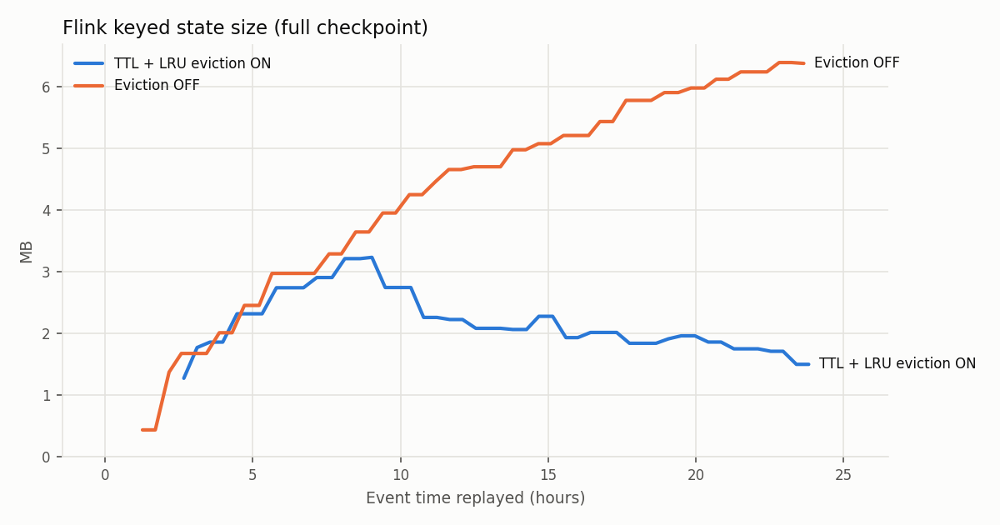

# Project Guide: Real-Time Session-Based News Recommendations on Apache Flink

**Subject:** Big Data Computing · **Guide:** Ms. Himanshi Jiwatramani
**Students:** Amey Vichave (51), Soham Tejwani (61) · VESIT, Department of AI & DS

This guide explains what the project does, how data moves through it, why each component exists, and what the
experiments show. It accompanies the written case study (`docs/case-study.pdf`); section numbers like "§4.2"
refer to that report.

---

## 1. The problem in one paragraph

A news app should show a breaking story to interested readers within seconds of publication. Classic recommenders
(collaborative filtering) can't do that: they rank articles by past clicks, and a brand-new article has none. This
is the **item cold-start** problem. Relevance also isn't constant. A story fades over hours (**time decay**), and a
breaking event can make a whole topic spike within minutes (**concept drift**). Solving both needs a system that
keeps per-user and per-topic memory *while the stream flows*. Without discipline, that memory grows forever. The
project therefore also treats **memory eviction** as a first-class design concern (the CA2 focus).

## 2. What we built

A complete pipeline that runs on one 8 GB laptop with Docker (4.5 GB budget):

| Layer | Technology | Role |
|---|---|---|
| Data | MIND-small (Microsoft News Dataset) | Real articles and real user impressions with click labels |
| Replay | Python producer | Emits articles and events to Kafka in event-time order at 60× speed |
| Messaging | Apache Kafka (KRaft) | Durable buffer between every stage |
| Edge cleaning | Kafka Streams (Java) | Schema validation, de-duplication, category enrichment, dead-letter queue |
| Stream processing | **Apache Flink (PyFlink)** | Cold-start embedding, session windows, decay and drift: the stateful heart |
| Embeddings | MiniLM transformer, INT8, ONNX Runtime | Turns an article's text into a 384-number vector in ~4 ms |
| Vector search | Qdrant (HNSW index) | Finds articles similar to a user's current interest |
| Wide-column store | ScyllaDB (Cassandra-compatible) | Session vectors, topic half-lives, item scores |
| Online learning | River (ADWIN) | Detects changes in topic engagement |
| Serving | FastAPI | `GET /recommend/{user}` within a 50 ms budget |
| Monitoring | Prometheus + Grafana | The evaluation metrics of §5.5 |
| UI | Next.js dashboard | Live demo |

## 3. Workflow: following one article and one click

### 3.1 An article is published (cold start)

1. **Replay → Kafka.** The producer publishes article `N12345` to `articles.raw`. MIND has no publication time,
   so we publish each article 30 s (event time) before its first impression. It reaches the system with **zero
   clicks**, which is a genuine cold start.
2. **Kafka Streams.** The cleaner validates the record against a JSON Schema, drops duplicates (an ID store purged
   every minute, so it stays bounded) and writes it to `articles.clean`. Invalid records go to `dlq` with a reason.
3. **Flink: micro-batching.** The `EmbedBatcher` operator buffers new articles in keyed state and flushes when 16
   have arrived or 500 ms have passed. Batching amortises model calls and Qdrant inserts (§4.3, "index churn").
4. **Embedding service.** The batch's titles and abstracts are encoded by an INT8-quantized MiniLM model. We
   quantize it ourselves at image build time. It is 35% smaller than FP32 and agrees with it at 0.992 cosine
   similarity.
5. **Qdrant.** The vectors are upserted in one call. From this moment the article is **retrievable by similarity**,
   with no click needed. Its "cold-start delay" is measured from publication to this point.
6. **Embedding cache.** The vector also enters a **bounded LRU cache held in Flink keyed state** (16 buckets × 128
   entries, medium TTL), and is published on `articles.embedded` for the serving API.

### 3.2 A user clicks (session personalisation)

1. The click goes `events.raw` → Kafka Streams, which adds the article's category → `events.clean`.
2. **Flink: cache join.** The click is joined with the article's vector from the LRU cache. On a miss (evicted or
   expired) it falls back to Qdrant, the durable source of truth. If the click arrives *before* the article has
   been embedded, it waits in a small pending buffer instead of being lost.
3. **Flink: event-time session window.** Clicks are keyed by user and grouped into **session windows with a 20-minute
   inactivity gap**. Watermarks allow 30 s of out-of-order arrival, so late mobile clicks still land in the right
   session. The window keeps a **decay-weighted mean** of clicked-article vectors, with recent clicks counting more.
   It fires on every click, so the session vector updates live.
4. The session vector is written to **ScyllaDB**. When the gap passes, Flink purges the window's state
   automatically (session-window purging, §4.2).

### 3.3 Topics decay and drift

1. Every impression and click is also keyed by **category** in the `TopicDecayDrift` operator.
2. A River **ADWIN** detector watches the engagement signal (1 = click, 0 = impression). ADWIN keeps an adaptive
   window and cuts it when the old and new parts differ significantly.
3. On a detected change we compare the window mean before and after the cut:
   - **spike** (engagement rose): the half-life is **halved**, so new items in the topic rise quickly;
   - **slow burn** (engagement fell): the half-life is **×1.5**, so still-relevant items stay visible longer;
   - between drifts the half-life **relaxes back** toward the 6 h default.
4. An article's warm score is `smoothed_CTR × exp(−ln2 · age / half_life_topic)`. Every 10 event-minutes the
   operator **rolls up** topic half-lives and item scores to ScyllaDB, so Flink never holds the full history.

### 3.4 A recommendation is requested

`GET /recommend/U123?k=10`:

1. Read the user's session vector from ScyllaDB (~3 ms).
2. Run an **ANN search** in Qdrant over fresh articles with the remaining budget (~10–15 ms).
3. **Blend**: `0.6 × similarity + 0.4 × normalised warm score`, and drop articles the user already clicked.
4. **50 ms guarantee.** If Qdrant would overrun, the API uses brute-force similarity over an in-memory cache of the
   2,000 most recent articles and counts it as a **fallback**. That is the report's "explicit, monitored
   degradation path" (§5.2). Users with no session get decayed popularity.

## 4. Memory governance (the CA2 contribution)

Without eviction, three kinds of state grow without bound: per-user sessions, per-article embeddings, and per-topic
statistics. Each gets its own discipline, all configured in one file (`config/pipeline.yaml`):

| State | Owner operator | Eviction | Why this length |
|---|---|---|---|
| Session windows | session window | Purged automatically after the 20 min gap | A session is over once the user leaves |
| Per-user recent clicks | session writer | State TTL **30 event-min** (short) | Matches the session gap |
| Embedding cache | cache join | **LRU bound** (16 × 128) + TTL **6 event-h** (medium), refreshed on read | An article's cold-start window |
| Pending clicks | cache join | TTL 6 event-h | Should drain within seconds |
| Topic and item counters | topic decay | TTL **24 event-h** (long) + roll-up to ScyllaDB | History lives in ScyllaDB |

Notes worth knowing for the viva:

- **RocksDB + compaction filter.** State lives in RocksDB (on disk, with a small managed-memory cache). With TTL on,
  Flink's compaction filter drops expired entries while RocksDB compacts. Checkpoints then carry only *live* state.
- **Incremental checkpoints every 30 s** upload only changed RocksDB files. **Unaligned checkpoints** let barriers
  overtake backpressured buffers, so checkpoints still complete under load.
- **TTL is processing-time in Flink**, so event-time TTLs are divided by the replay speed-up (6 event-h at 60× =
  6 wall-min).

## 5. Results

### 5.1 Live metrics (§5.5)

| Metric | Result | How measured |
|---|---|---|
| Cold-start coverage | 68% of articles retrievable within 10 s at **120×** replay (median 8.6 s); at 60×, recent articles take 3–8 s | `newsrec_coldstart_*` metrics, publication → Qdrant upsert ack |
| Recommendation latency | p50 ≈ 21 ms under 20 req/s; fallback path keeps degraded requests near the 50 ms budget | `/stats`, `newsrec_recommend_latency_seconds` |
| Fallback rate | ~12% while the replay is writing heavily to Qdrant, ~0% when idle | `newsrec_fallback_total` |
| Drift-detection lag | Burst on *sports* detected as a **spike** after **188 s of event time** (≈ 3 event-min; 37 s wall); half-life 6 h → 3 h, then relaxing 3.15 → 3.56 h | burst marker vs first `drift.events` spike |
| Data quality | 6/6 malformed records sent to the DLQ with reasons; 10/10 duplicates dropped | `make counts` after `replay.inject_bad` |

### 5.2 Offline recommendation quality (MIND labels)

The evaluation replays the subset in time order and scores each day-2 impression using only earlier information:

| Model | AUC | MRR | nDCG@5 | nDCG@10 |
|---|---|---|---|---|
| Random | 0.503 | 0.256 | 0.267 | 0.321 |
| Popularity (clicks so far) | 0.621 | 0.348 | 0.366 | 0.413 |
| **Decayed CTR** (our warm score) | **0.654** | 0.379 | 0.398 | 0.442 |
| Session blend (our serving formula) | 0.655 | 0.379 | 0.399 | 0.442 |
| History blend (cross-session upper bound) | 0.705 | 0.403 | 0.427 | 0.477 |

On the 204 impressions where the user had a **live session**, the session blend improves on decayed CTR (AUC 0.611 vs
0.591). Only 4.4% of impressions have a live session in this subset, so the overall gain is small. The history blend
shows the value of the report's §6 "cross-session personalisation" future work.

### 5.3 Eviction ablation (the core CA2 result)

We replayed the same 24 hours of event time (at 120×) twice from completely fresh state: once with all TTLs and the LRU
bound enabled, once with them disabled (`--eviction off`). Every 10 s we sampled Flink's latest checkpoint and the
TaskManager's memory. A watchdog would stop a run at 90% of the TaskManager limit.

| Run | Final keyed state | Peak keyed state | Mean checkpoint | Peak TM memory |
|---|---|---|---|---|
| Eviction **ON** | **1.47 MB** | 3.23 MB | 11.1 s | 892 MiB |
| Eviction **OFF** | 6.38 MB | 6.40 MB | 8.2 s | 888 MiB |

How to read it:

1. **Without eviction, state only grows**, roughly linearly with the number of articles and users seen (about 0.27 MB
   per event-hour). **With eviction it is bounded.** It rises until the 6-hour embedding-cache TTL starts expiring
   entries, peaks at about 9 h, then falls and flattens. After 24 h the evicting job holds **4.3× less state**, and
   the gap widens every day.
2. **Checkpoint duration did not improve at this scale.** With only a few MB of state, a checkpoint's duration is
   dominated by barrier alignment under backpressure and PyFlink's bundle flushes, not by bytes. The evicting run
   was slightly slower on average, which fits the extra delete and compaction work. This is an honest negative
   result: eviction pays off in size, upload volume and recovery time, which grow with the state, not in latency at
   small scale.
3. **TaskManager memory was the same** (about 890 MiB) and the watchdog never fired. RocksDB keeps state on disk and
   within a fixed managed-memory budget, so a few MB of state doesn't move container memory. The JVM and PyFlink
   workers dominate it. In production, with millions of keys, the same unbounded slope is what exhausts disk,
   checkpoint storage and restore time.

Plots: `reports/ablation_state_size.png`, `reports/ablation_checkpoint_duration.png`, `reports/ablation_memory.png`.

## 6. Engineering problems we hit (and what they teach)

| Problem | Cause | Fix |
|---|---|---|
| ScyllaDB refused to start | Seastar reserves memory outside `--memory`; 600M didn't fit a 700 MB container | `--memory 500M` |
| Kafka would have deleted the replay immediately | 1 h retention + 2019 timestamps = "expired" | Event time travels in the payload; Kafka timestamps are ingestion time |
| PyFlink crashed on TTL cleanup | `cleanup_in_rocksdb_compact_filter()` needs the JVM gateway inside Python workers | Rely on the default background cleanup (which is the compaction filter for RocksDB) |
| Clicks lost under load | A click could arrive before its article's embedding | Pending-click buffer in keyed state |
| Drift reported as "slow burn" during a burst | A fast EWMA baseline absorbed the burst before ADWIN fired | Compare ADWIN's own window mean before vs after the cut |
| Topic operator capped at ~50–115 events/s | PyFlink process mode makes a gRPC round trip per state access | Accumulate counters in memory and write state once per roll-up |
| Serving p95 ≈ 240 ms | Bulk score refresh shared the DB connection; fallback rebuilt a matrix per request | Separate DB session; cached fallback matrix; 15 ms reserve |

## 7. How to demonstrate it (≈ 10 minutes)

1. `make up-all` (core + monitoring), then `make replay` in one terminal.
2. Open http://localhost:3000. Articles appear as **COLD → FRESH → WARM**, and the coverage tile fills.
3. **User recommendations** page: pick an active user and watch the list re-rank as they click.
4. Run `make burst` (sports). On the **Topics** page the sports half-life drops at the burst (orange dot), and the
   overview shows the detection lag.
5. Run `curl -X POST "localhost:8000/admin/qdrant-delay?ms=80"`. Requests switch to **FALLBACK** and stay near the
   budget. Set it back to 0.
6. Flink UI (http://localhost:8081): show the job graph, checkpoints and backpressure. Grafana
   (http://localhost:3001/d/newsrec): state size per state name and checkpoint duration.

## 8. Likely viva questions

- **Why Flink and not Spark Streaming?** Flink is a true record-at-a-time stateful engine. It has keyed state,
  event-time session windows with watermarks, state TTL and incremental checkpoints as first-class features.
  Micro-batching adds latency, and Spark's state store has fewer eviction controls.
- **How does a new article get recommended with zero clicks?** Its text embedding is close to the user's session
  vector in the same 384-dimensional space, so ANN search finds it within seconds of publication.
- **What exactly is evicted, and when?** See the table in §4. Windows are purged at the session gap. TTL expires
  per-key state, and RocksDB's compaction filter physically removes it. The LRU bound caps the embedding cache by
  count.
- **What happens if the TaskManager crashes?** Flink restores keyed state from the last incremental checkpoint and
  rewinds the Kafka offsets to match. The only approximation is topic counters accumulated since the last roll-up
  (≤ 10 event-minutes), which is documented.
- **Why INT8?** Smaller model and faster CPU inference within the 50 ms budget. We measured 0.992 cosine agreement
  with FP32, so ranking quality is preserved.
- **Why ScyllaDB/Cassandra?** Write-heavy workload with frequent overwrites of recent rows (half-lives, scores,
  session vectors) and simple key lookups, which is what wide-column stores are built for.

## 9. Repository map

| Folder | Contents |
|---|---|
| `replay/` | dataset download, subset builder, replay producer, burst injector, load generator, data checks |
| `kafka-streams/` | Java cleaner (validation, dedup, enrichment, DLQ) |
| `flink-jobs/newsrec/` | the PyFlink job (`job.py`) and operators (`operators.py`) |
| `newsrec_core/` | pure logic shared by Flink and serving: decay, LRU, drift rule, session vector, blend |
| `embedding-service/` | INT8 quantisation script, encoder, FastAPI micro-batcher |
| `serving-api/` | `/recommend` and the monitoring JSON endpoints |
| `dashboard/` | Next.js demo UI |
| `eval/` | offline evaluation and the eviction ablation |
| `infra/` | ScyllaDB schema, bootstrap, Prometheus and Grafana config |
| `tests/` | 38 unit tests and the end-to-end smoke test |
| `reports/` | evaluation tables, ablation plots |
